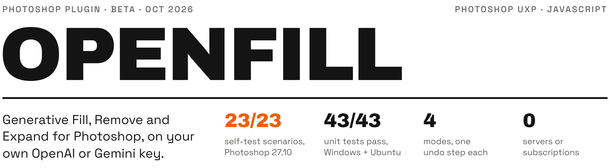

<picture>
  <source media="(max-width: 600px) and (prefers-color-scheme: dark)" srcset=".github/assets/header-phone-dark.png">
  <source media="(max-width: 600px) and (prefers-color-scheme: light)" srcset=".github/assets/header-phone-light.png">
  <source media="(prefers-color-scheme: dark)" srcset=".github/assets/header-dark.png">
  <source media="(prefers-color-scheme: light)" srcset=".github/assets/header-light.png">
  
</picture>

OpenFill adds Generative Fill, Remove, Expand and Variations to Photoshop 2023 (24.4+) to 2026, powered by your own OpenAI or Google Gemini key. It is a UXP plugin that talks to the service directly: no server, no subscription, and it works without the Creative Cloud app. MIT licensed.

[Releases](../../releases) · [](https://github.com/damanjz/openfill/actions/workflows/ci.yml)

> [!NOTE]
> **v0.1.0 beta.** Verified in Photoshop 2026 (27.10) by an in-Photoshop self-test: fill, remove, expand, variations, 300 ppi, 16-bit, 24 MP photos, transparency, undo, rollback on errors, and live connections to both services. Not yet verified: a paid end-to-end generation, and Photoshop 2023 to 2025. Reports are welcome in [Issues](../../issues).

## Results

| Figure | Result | How it is produced |
|---|---|---|
| Self-test scenarios | 23 of 23 pass on Photoshop 2026 (27.10) | The in-Photoshop self-test (`plugin/src/selftest.js`, dev builds only), run on throwaway documents with a stand-in AI service; recorded in `docs/spec.md` |
| Unit tests | 43 of 43 pass | `npm test`; CI run 38177260079 on `main`, 2026-10-11, on Windows and Ubuntu with Node 22 and 24 |
| Modes | 4, one undo step each | Fill, Remove, Expand and Variations, below; every result lands as a single undo step |
| Servers or subscriptions | 0 | The plugin calls OpenAI or Gemini directly with your key (`plugin/src/providers/`); you pay the service per image |

## How it works

1. **Read.** OpenFill reads your selection plus some surrounding context, at full resolution. Photoshop isn't changed.
2. **Generate.** It sends that crop and a mask to the service you picked, using your key. Photoshop stays free to use meanwhile.
3. **Place.** The result is scaled back exactly onto the crop, placed as a smart object and clipped to your exact selection with a soft edge, all in one undo step. If anything fails, the document is left as it was.

## What it does

| Mode | |
|---|---|
| **Fill** | Select an area and describe what goes there. Leave the prompt empty to blend the area away. |
| **Remove** | Select an object and press Remove. The background behind it is rebuilt. |
| **Expand** | Add 1 to 200% on any sides. The new canvas continues the picture. |
| **Variations** | Get 1 to 4 results per run and click a thumbnail to switch between them. |

Every result lands as smart-object layers in a group masked to your selection, as a single undo step. Photoshop stays usable while the AI works.

## Models

| Service | Models | Get a key |
|---|---|---|
| OpenAI | GPT Image 2.5 Sunburst (default), GPT Image 2.5 Flare, GPT Image 2, or any model ID | [platform.openai.com/api-keys](https://platform.openai.com/api-keys) |
| Google Gemini | Nano Banana 2.1 (default), Nano Banana Pro, Nano Banana 2 Lite, or any model ID | [aistudio.google.com/apikey](https://aistudio.google.com/apikey) |

You pay the service directly, per image. Both need a funded account: OpenAI needs credits, and Gemini's free tier allows 0 image generations, so billing must be on. OpenAI image models may also need your organization verified. When one of these blocks a run, OpenFill names it and links the page that fixes it.

## Quick start

### Install

**With the Creative Cloud app**

1. Download `openfill-<version>.ccx` from [Releases](../../releases).
2. Double-click it.

**Without the Creative Cloud app (Windows)**

1. Download `openfill-<version>-windows.zip` from [Releases](../../releases) and unzip it.
2. Close Photoshop.
3. Double-click **Install OpenFill.bat**. No admin rights needed.

<details>
<summary>What the Windows installer changes</summary>

- Copies the plugin to `%APPDATA%\Adobe\UXP\Plugins\External\io.github.damanjz.openfill`.
- Adds one entry to Photoshop's plugin list, `%APPDATA%\Adobe\UXP\PluginsInfo\v1\PS.json`, after saving a backup copy next to it. Other plugins are left untouched.
- **Uninstall OpenFill.bat** removes both again.

</details>

Then start Photoshop and open **Plugins > OpenFill**.

### Use

1. In the panel, open **API keys**, paste a key and press **Save keys**. Keys stay on your computer, in Photoshop's secure storage.
2. Choose **Fill**, **Remove** or **Expand**.
3. Make a selection (Expand doesn't need one), add a prompt if you like, and press the button.

**Resolution** is 2K by default. 4K is sharper on large areas but slower and costs more.

### Develop

```bash
npm test          # 43 unit tests, no dependencies
npm run package   # builds dist/openfill-<version>.ccx and -windows.zip
```

Load `plugin/` in Adobe's UXP Developer Tool, or install a dev copy with `installer/install.ps1 -Source plugin`. To add a service, write one file in `plugin/src/providers/` with the same shape as `openai.js` and list it in `providers/index.js`.

<details>
<summary>In-Photoshop self-test</summary>

Dev installs only; release packages leave it out. With the OpenFill panel open, write `{}` to `selftest.json` in the plugin's data folder:

```
%APPDATA%\Adobe\UXP\PluginsStorage\PHSP\<version>\External\io.github.damanjz.openfill\PluginData
```

It runs every scenario on throwaway documents with a stand-in AI service and writes `selftest\result.json` plus PNG snapshots. Don't touch Photoshop while it runs. `{"only":["fill"]}` runs one scenario; `{"live":"openai"}` runs three real, paid generations with your saved key.

</details>

## Repo layout

```
plugin/
├── manifest.json        # UXP manifest (id io.github.damanjz.openfill)
├── index.html, main.js  # the panel
├── styles.css
├── icons/
└── src/
    ├── pipeline.js      # read, generate, place; host-free, tested with fakes
    ├── photoshop.js     # every Photoshop call
    ├── providers/       # one file per service: openai.js, gemini.js
    ├── image.js, png.js, geometry.js, bytes.js
    └── selftest.js      # in-Photoshop self-test, left out of release packages
installer/               # Install / Uninstall OpenFill.bat and their PowerShell scripts
scripts/package.js       # builds the .ccx and the Windows zip
test/                    # unit tests (Node's built-in runner)
docs/spec.md             # spec and test plan
```

## Limits

- The services return at most about 4K pixels. Filling most of a large photo means upscaling, which looks softer; the panel tells you when that happens.
- The services treat the mask as a guide, not a hard edge. OpenFill clips their result to your selection.
- Cancel stops OpenFill from using a result, but the service may still bill the request it already received.
- The Windows installer is Windows only; on macOS use the `.ccx`.

## Contributing

Contributions are welcome. Every pull request runs the automated tests, gets a code review, and needs the maintainer's approval before it merges; releases are published by the maintainer only. See [CONTRIBUTING.md](CONTRIBUTING.md). Security problems: [SECURITY.md](SECURITY.md).

## Licence

[MIT](LICENSE)
